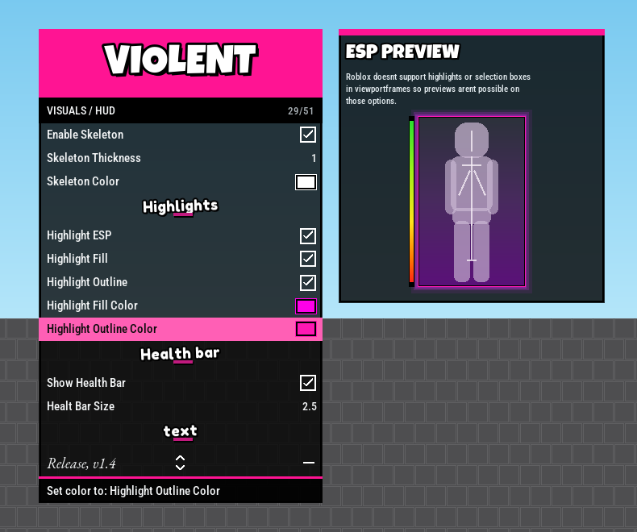

# VIOLENT — standalone client-sided menu (UI replica)

A complete, modular Luau re-creation of the menu in the reference screenshot:
the pink `VIOLENT` header, the `VISUALS / HUD` strip with its `29/51` counter,
all eleven rows and three section headings, the translucent body, the pink
footer, and the `ESP PREVIEW` window with its gradient box, health bar,
silhouette and bloom.

**It is interface only.** Every feature hook is an empty function in
`src/Stubs.lua`. There is no ESP, no combat, movement, farming or automation
logic anywhere in this folder — only the UI and the view-state needed to drive
it (checkbox states, numbers, selected colour, counter).



*(Preview rendered from the instance tree with stand-in fonts; Roblox output
uses the in-engine fonts listed below.)*

## Run it

The ready-to-run build is one self-contained file: **`dist/Violent.lua`**.

Either paste its entire contents into the executor and execute, or load it:

```lua
loadstring(game:HttpGet(
    "https://raw.githubusercontent.com/XzAngel19/ARandomMenu/refs/heads/arena/4c7278e1-arandommenu/violent-ui/dist/Violent.lua"
))()
```

Requirements: a normal Roblox client + a script executor that exposes
`game`, `Instance`, `task` and (optionally) `gethui`/`syn.protect_gui`.
No Studio-only APIs are used, and the ScreenGui is parented with a fallback
chain: `gethui()` → `CoreGui` → `PlayerGui`.

Visibility: **RightShift** toggles both windows.
Teardown: `getgenv().VIOLENT_UI.Destroy()`.

## Interaction

| Element | Behaviour |
| --- | --- |
| Header / preview panel | Drag to move (position clamped on screen) |
| Checkbox rows | Flip the checkbox, update `29/51`, fire the toggle stubs |
| Value rows (`1`, `2.5`) | Click to step the value (`Skeleton Thickness` +1, `Healt Bar Size` +0.5), fire the value stub |
| Colour rows | Click the row or its swatch to make it the active colour target; the row turns pink and the footer becomes `Set color to: <name>` |
| Swatch | Also fires the empty colour-picker hook |
| `Release, v1.4` | Up/down chevrons fire the version-step stub; the label stays put because the feature is stubbed |
| `Set color to:` bar | Status text driven by the selected colour row |
| RightShift | Show/hide |

The reference shows one page and no sidebar, so none is invented. `Page`
already supports multiple pages; adding navigation would mean mounting a second
`Page` and calling `PageChanged`, not changing the components.

## Modules

The bundle is generated from these files; the single-file build keeps the same
boundaries through a tiny `define`/`require` registry.

```
violent-ui/
├── src/
│   ├── Theme.lua      palette, fonts, all measurements
│   ├── Util.lua       instance builder, strokes, safe parenting, dragging
│   ├── State.lua      view state: toggles, values, colours, counter
│   ├── Controls.lua   toggle / value / colour / section / selector rows
│   ├── Window.lua     pink header + wordmark, translucent body, footer
│   ├── Page.lua       tab strip, counter, scrolling row list
│   ├── Preview.lua    ESP PREVIEW window (box, gradient, figure, health bar)
│   ├── Menu.lua       assembles the page and wires state → stubs
│   ├── Stubs.lua      every feature hook — intentionally empty
│   └── Main.lua       ScreenGui mount, keybind, public API, teardown
├── dist/Violent.lua   generated single-file build
├── tests/             mock Roblox runtime + smoke test + preview renderer
└── build.py           bundles src/ → dist/
```

Public entry point (returned by the bundle and stored on `getgenv()`):

```lua
local ui = getgenv().VIOLENT_UI
ui.Toggle()          -- show/hide
ui.SetVisible(false)
ui.State             -- read-only view state
ui.Menu              -- Window / Page / Preview objects
ui.Destroy()
```

## Wiring real features (not included)

Every control produces a hook and nothing else. Replace the no-op bodies in
`src/Stubs.lua`:

```lua
Stubs.Visuals.SetSkeleton = function(enabled) end
Stubs.Visuals.SetSkeletonThickness = function(value) end
Stubs.ColorPicked = function(controlId, color) end
```

`State` is updated before the stub runs, so a real feature can read
`Main.State.toggles`, `.values` and `.colors` at that point.

## Fidelity notes

* Measurements were taken from the reference (307 × 507 px window) and scaled
  to the 352 × 588 design size: 85 px header, 32 px tab strip, 29 px rows,
  38 px section blocks, 3 px pink divider, 30 px footer.
* The body is translucent black (76% opacity), which is why rows over the sky
  read dark slate and rows over the ground read near-black in the screenshot.
  The build reproduces that rather than faking two background bands.
* Fonts fall back defensively: `LuckiestGuy` for the wordmark and preview
  title, `FredokaOne` for the mixed-case section headings (`Highlights`,
  `Health bar`, `text`), `GothamMedium` for body text, and an italic Garamond
  `FontFace` for `Release, v1.4`. The reference's condensed display face
  (Burbank-style) is not a built-in Roblox font, so the closest heavy display
  faces are used.
* Labels and values are reproduced verbatim, including the reference's
  `Healt Bar Size` spelling, `doesnt`/`arent`, and the three explicit
  description line breaks.
* `29/51` is 24 non-visible features plus the five visible toggles, so the
  counter is 29/51 on load and moves as the visible checkboxes change.
* `Release, v1.4` does not cycle: no release list is visible in the reference,
  so the selector only exposes the empty `VersionStepped` hook.

## Build & test

```bash
python3 violent-ui/build.py          # regenerate dist/Violent.lua
python3 violent-ui/build.py --check  # fail if the bundle is stale
python3 violent-ui/tests/run_mock.py       # 36 structural/interaction checks
python3 violent-ui/tests/run_fallbacks.py  # gethui/Font.new fallback checks
tools/luau/bin/luau-compile violent-ui/dist/Violent.lua   # syntax check
```

`tests/run_mock.py` and `tests/run_fallbacks.py` execute the real bundle against `tests/mock_roblox.lua`
(a small Instance/Enum/Signal mock), asserts the whole tree, the row order and
labels, the counter and footer behaviour, drag, the keybind and teardown.
`tests/render_preview.py` is the optional software renderer behind
`docs/preview.png`; it expects stand-in TTFs in `/tmp/fonts/out` and falls back
to DejaVu.
